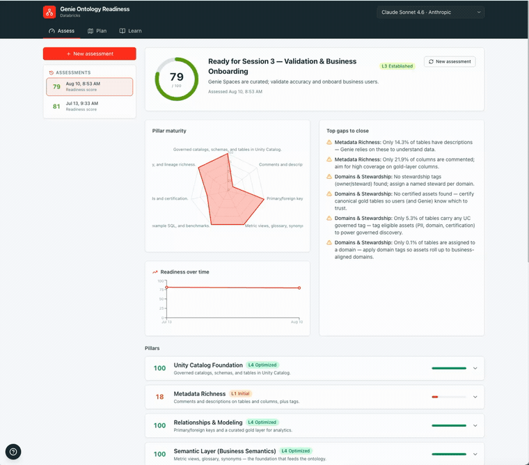
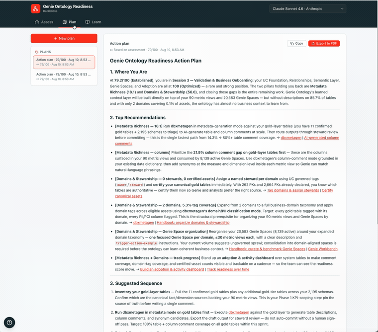
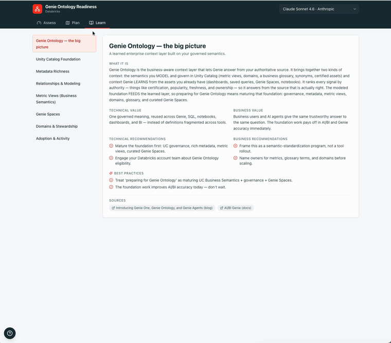

# Genie Ontology Readiness

A self-contained Databricks App that helps a customer **prepare for Genie Ontology**.
Deploy it into a workspace and it will:

- **Assess** the live environment and score maturity across the readiness pillars
  Genie Ontology depends on (Unity Catalog, metadata, relationships, metrics /
  metric views, Genie Agents, domains, adoption).
- **Explain** each capability from a **technical** and a **business** standpoint, with
  accurate GA / preview status.
- **Recommend** best practices for both technical enablement and business adoption.
- **Generate** a tailored, sequenced enablement + adoption plan and answer questions
  via an AI assistant — powered by the customer's **own Foundation Model API**.

The assessment is **read-only** and degrades gracefully when a signal isn't available.

> Genie Ontology is the *learned* enterprise context layer (gated preview) built on the
> customer's *governed* UC Business Semantics foundation (largely GA). Preparing for it =
> maturing that foundation. See `CLAUDE.md` for the product framing and full deploy steps.

## Walkthrough

The app has three tabs. Each walkthrough below is a short, sped-up screen capture.

### Assess — the 7-pillar readiness scorecard

Run a read-only assessment that scores your workspace across seven pillars, rolls up to a
0–100 readiness score and maturity stage, and expands each pillar to its signals and gaps.



### Plan — a tailored action plan

Generate a prioritized, tactical action plan from a saved assessment — grounded in your real
scores and gaps and powered by your workspace's own Foundation Model API.



### Learn — enablement and accelerators

Explore each capability from a technical and a business angle, with best practices, downloadable
guides, and the public Databricks accelerators that raise each pillar's score.



## Quick start

Install and upgrade the app **inside your Databricks workspace**. You do not need Node.js,
npm, the Databricks CLI, or Python on your laptop. The Databricks Apps runtime builds the
frontend during the deploy. Use the notebook installer for both steps.

The steps use the Git folder UI. See Databricks docs:
[Create and manage Git folders](https://docs.databricks.com/aws/en/repos/git-operations-with-repos).

### First install

1. Find the latest release tag on the
   [Releases page](https://github.com/databricks-solutions/genie-ontology-readiness/releases).
2. In the workspace, click **Create** → **Git folder**. Paste this repo's URL:
   `https://github.com/databricks-solutions/genie-ontology-readiness.git`. Select the latest
   release tag in the branch field. Click **Create Git folder**.
3. Open `notebooks/install.py` from the Git folder. Attach it to **Serverless** compute.
4. Set the widgets at the top of the notebook:
   - `warehouse_id`: empty uses the first SQL warehouse you can see. Or set your own id.
   - `lakebase_instance_name` and `lakebase_database`: optional. They turn on per-user history.
     Use an existing Lakebase instance. Leave them empty to run without history.
   - `assess_catalogs` and `brand_name`: optional.
5. Click **Run all**.

The notebook creates the app and its service principal first. Then it sets up history in the
same run. The app is ready when the last cell shows the app link. You do not need a second run.

### Upgrade to a new release

An upgrade keeps your settings and your history. Use the same Git folder you created for the
first install.

1. Open the Git folder. Click the **Git** button beside the repo name, or the button next to
   the notebook name that shows the current branch.
2. In the branch dropdown, select the new release tag. Then click **Pull**. See
   [Create and manage Git folders](https://docs.databricks.com/aws/en/repos/git-operations-with-repos).
3. Open `notebooks/install.py`. Leave **all widgets empty**. Click **Run all**.

The notebook reads the deployed app. It prints a table of each setting and its source
(`you set`, `deployed app`, `new release`, `live`, or `default`). Then it deploys the new
release from the same folder.

**What is kept**

- The history database on Lakebase, with past runs and plans. The upgrade does not drop it.
  A schema change only adds columns.
- Every setting. The warehouse, catalogs, Genie space, brand, and Lakebase instance and database
  come from the deployed app.
- A setting that the new release adds takes the release default.

**Change one setting.** Fill in only that widget. Leave the others empty. For example, fill in
`brand_name` only. To clear a value, use the CLI path below, which can set a value to empty.

**Start fresh.** Set `reset_settings` to `true`. The notebook then ignores the deployed settings.
Each widget you did not fill in uses the release default. If you do not set the Lakebase
widgets, the app stops using its history. The old history stays in Lakebase.

**The notebook stops before it changes anything if:**

- The deployed app's `app.yml` cannot be read. The stop message names the folder. Ask a user
  who can read it, or an admin, to run the upgrade.
- This run would turn Lakebase history off.
- This run would point the app at another Lakebase instance or database.

**Roll back.** Select the previous release tag in the Git folder, click **Pull**, then
**Run all** on `notebooks/install.py` with empty widgets. A schema change only adds columns, so
the previous release can still read the history.

**Do not:**

- Delete the app in the Apps page. Use the upgrade instead.
- Drop the Lakebase history database.
- Change `lakebase_database` unless you want a new, empty history. A new name starts a new
  database, and the old history is not used.

**Run on demand as a job (optional).** You can run `notebooks/install.py` as a Databricks job
task to redeploy on demand. Set the widgets as job parameters. Do not add a schedule that pulls
new releases. Upgrades are a deliberate step.

### Advanced: deploy from a terminal or CI

Use this path only if you already work with the Databricks CLI, or if a pipeline deploys the app.
It needs Node.js for the frontend build, the Databricks CLI, and Python 3.9+. It uses the same
settings and the same safety stops as the notebook.

Clone the release from a terminal:

```bash
# Stable: the latest release (recommended)
tag=$(gh release view --repo databricks-solutions/genie-ontology-readiness --json tagName -q .tagName)
git clone --branch "$tag" https://github.com/databricks-solutions/genie-ontology-readiness.git
# (no gh? use the Releases page above and: git clone --branch <tag> <repo-url>)
```

**First install** (from the repo root):

```bash
# 1. Build the frontend
cd app/frontend && npm install && npm run build && cd ../..

# 2. Create the app and its SQL warehouse resource
databricks bundle deploy -t prod --profile <p> --var="warehouse_id=<id>"

# 3. Grant the app read access, set up history, and deploy the app
export DATABRICKS_PROFILE=<p>
export TARGET=prod
export WAREHOUSE_ID=<id>
export USE_LAKEBASE=true                        # optional: per-user history
export LAKEBASE_INSTANCE_NAME=<instance>        # an existing Lakebase instance
export LAKEBASE_DATABASE=ontology_readiness
python3 scripts/post_deploy.py
```

**Upgrade** (from the repo root, after you check out the new tag):

```bash
# 1. Get the new release
git fetch --tags origin
git checkout "$(gh release view --repo databricks-solutions/genie-ontology-readiness --json tagName -q .tagName)"

# 2. Build the frontend
cd app/frontend && npm install && npm run build && cd ../..

# 3. Upgrade the app in place
DATABRICKS_PROFILE=<p> TARGET=prod python3 scripts/post_deploy.py
```

Use the same `TARGET` as the first install. Do not set `WAREHOUSE_ID` or any other setting. The
script reuses each deployed value, the same as the notebook. To change one setting, set only that
variable. An empty value clears it, for example `ASSESS_CATALOGS=`.

- **Start fresh:** `RESET_SETTINGS=true`. Each setting you do not set uses the release default.
- **Infrastructure change** (the release notes say `databricks.yml` changed): `INFRA=true`. This
  runs `bundle deploy`. It needs the bundle state of the first install. If you are not the user
  who ran it, bind the app first with
  `databricks bundle deployment bind ontology_readiness <app-name> -t prod`.
- The script stops with a message before it changes anything, under the same conditions as the
  notebook.

The `-t <target>` selects the environment and fixes the app name (`dev` → `genie-ontology-readiness-dev`,
`stg` → `…-stg`, `prod` → the bare `genie-ontology-readiness`). There is no `--var app_name`.
Never run `bundle destroy`, and never drop the history database.

### Run the assessment without the app (Genie Code skill)

If your workspace can't install Databricks Apps (security review, deployment, or
service-principal constraints), use the standalone skill in
[`skills/genie-ontology-readiness/`](skills/genie-ontology-readiness/) instead. The
Genie Code agent runs the same read-only `information_schema` and system-table SQL as
the app, using **your own** Unity Catalog permissions. It produces the same seven-pillar
scorecard, maturity level, readiness stage, and prioritized gaps, with no app, app
service principal, or Lakebase.

1. Publish the skill folder (`SKILL.md` + `references/`) as a Unity Catalog skill in a
   catalog/schema you own, or copy it into your workspace skills folder.
2. In Genie Code, ask *"Assess this workspace's Genie Ontology readiness"* (or invoke
   `genie-ontology-readiness`).
3. You need `USE CATALOG` + `SELECT` on the catalogs to assess. `SELECT` on
   `system.information_schema`, `system.access.audit`, `system.query.history`, and
   `system.access.table_lineage` makes the result richer. A pillar whose reads are
   denied is reported as *unavailable*; it doesn't fail the run.

The skill transcribes the app's scoring (`app/server/pillars.py`,
`app/server/assessment/`). Scoring changes must update both together.

## Permissions required

The app reads only **metadata** (`information_schema`, tags) and **system tables**
(`system.access.*`, `system.query.*`) — never your actual table data. Every signal
defaults to **on-behalf-of-user (OBO)** with an automatic **SP fallback**:

- **Interactive** — a person viewing the app. With **on-behalf-of-user (OBO)**
  authorization enabled, **every signal runs as the viewing user** (their own Unity
  Catalog + system-table grants), so the assessment reflects exactly what *you* can
  see. If a given read fails because you lack a grant the app SP holds (system
  tables are the common case), that read **falls back to the app SP** rather than
  dropping the signal.
- **Scheduled / unattended** — snapshot history or any background run with no user
  present (also local dev). With no forwarded token every read runs as the app
  **service principal (SP)**, so the SP must hold the grants below.

A few reads are **always** the SP (they can't run OBO): the Genie REST API (not
covered by the `sql` user scope) and Lakebase credential minting.

### Who needs what

| Assessment area | Reads from | Grant needed (held by the **viewer** under OBO, or by the **SP** when unattended) |
|---|---|---|
| Run any query | SQL warehouse | `CAN USE` on the warehouse |
| UC Foundation · Metadata · Relationships · Metrics · Domains (tags) | catalog / `system.information_schema` | `BROWSE` on each assessed catalog (metadata-only, least privilege) — or `USE CATALOG`+`USE SCHEMA`+`SELECT` |
| "Not in Unity Catalog" coverage | `hive_metastore.information_schema` | read on `hive_metastore` (if legacy access is enabled) |
| Genie Agents (count + activity) | `system.access.audit` (`aibiGenie` events) | `USE`+`SELECT` on `system.access` |
| Adoption & Activity | `system.access.audit`, `system.query.history` | `USE`+`SELECT` on `system.access` and `system.query` |
| Top‑10 most‑accessed + certified | `system.access.table_lineage` + `information_schema.table_tags` | `USE`+`SELECT` on `system.access` + catalog metadata |
| Plan / Assistant (LLM) | Foundation Model API | model serving / FMAPI enabled for the workspace |

> [!NOTE]
> **SP fallback.** Under OBO each signal is attempted **as the viewer first**. If
> that read fails — most commonly because the viewer lacks a grant the app SP holds
> (system tables such as `system.access` / `system.query`) — the app **transparently
> retries the same read as the service principal** instead of dropping the signal.
> This means a signal can appear in the assessment even when the viewer can't read
> it directly, *provided the SP is granted*. If neither the viewer nor the SP holds
> the grant, the signal degrades to "not available." The fallback is per-read and
> lives in `app/server/sql_client.py` (`execute_sql`); the SP-only reads that never
> attempt OBO (Genie REST, Lakebase) are opted out with `force_sp=True`.
>
> **SP-only mode.** To disable OBO entirely at deploy time, set the `FORCE_SP=true`
> env (in `app.yml`, or `export FORCE_SP=true` before `post_deploy.py`). Every read
> then runs as the app SP regardless of any forwarded viewer token — useful when you
> want consistent, workspace-wide system-table signals (e.g. Adoption) that don't
> vary by who's viewing. The SP must hold the grants below. Default is `false`.

`scripts/setup_app_permissions.py` (run by `post_deploy.py`) applies the SP grants; see
**[CLAUDE.md](./CLAUDE.md)** for the exact statements and the OBO details.

## Stack

FastAPI + React/Vite + Tailwind, deployed as a Databricks App via Databricks
Asset Bundles.

## License

Provided under the **Databricks License** — see [`LICENSE.md`](./LICENSE.md) and
[`NOTICE.md`](./NOTICE.md). Third-party dependencies are subject to their own licenses,
declared in the respective package manifests.

## Support

This project is a Databricks **Field Engineering solutions example**, published as a
demonstration accelerator. It is **not** an official Databricks product and is **not**
covered by any Databricks Support agreement, SLA, or warranty.

- **Provided AS-IS**, with no warranties or conditions of any kind. There are **no SLAs**
  and no commitment to maintenance, bug fixes, or future updates.
- **Community / field-maintained** on a best-effort basis by the owner below — not
  staffed by Databricks Support or Engineering.
- **Not a substitute for official guidance.** Validate GA / preview status against the
  official [Databricks documentation](https://docs.databricks.com/) before making
  decisions.
- To report a security issue, see [`SECURITY.md`](./SECURITY.md).

For questions or issues, **open an issue on this repository** or contact the maintainer:
**Allan Cao** (`allan.cao@databricks.com`). See [`NOTICE.md`](./NOTICE.md) for the full
disclaimer.
